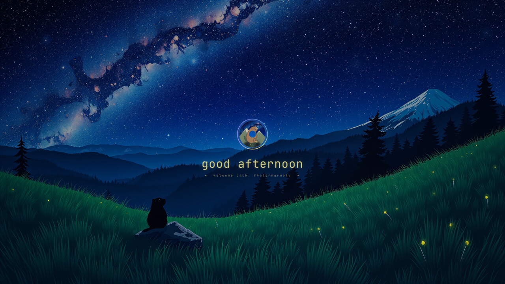

# Starwatch Intro

A one-shot animation of about 5.6 s that plays when your desktop first appears after boot. The night sky fades and zooms in, fireflies gather toward the centre, a marmot badge blooms inside a drawn ring with a greeting, and then an iris opens onto your desktop.



- It plays once per boot, tracked by a marker in `$XDG_RUNTIME_DIR`. Restarting the shell won't replay it.
- It is click-through, so it never blocks input, and it unloads itself when done.
- It uses your current wallpaper. The sky is animated on `*starwatch*` wallpapers such as the one in the [Alpine Marmot theme](https://github.com/prostratepossum/omarchy-alpine-marmot-theme).

## Install

```bash
omarchy plugin add https://github.com/prostratepossum/omarchy-starwatch-intro --enable
```

## Use

```bash
omarchy-shell -q intro play   # replay now
omarchy-shell -q intro stop
```

## Remove

```bash
omarchy plugin remove io.github.prostratepossum.starwatch-intro
```

## Dependencies

None beyond Omarchy (Quickshell / Qt 6).

## License

Code: MIT. The badge art is for personal use only. See [LICENSE](LICENSE).
